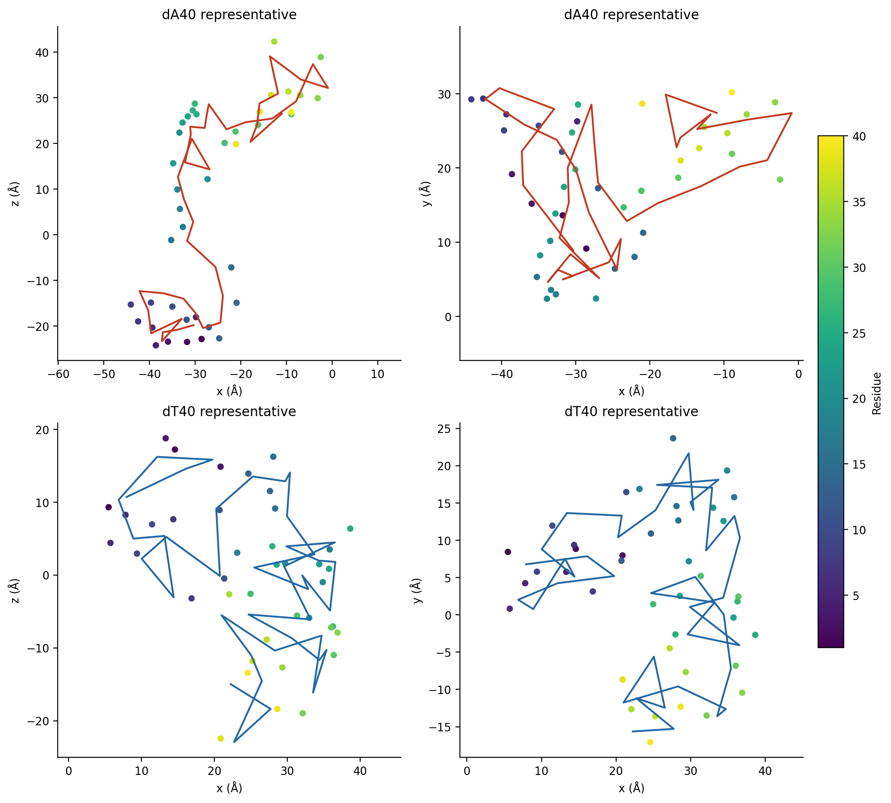

# ssDNA and nanopore simulations in 3 M KCl

This repository contains poly(dA)40 and poly(dT)40 DNA-only simulations plus
DNA–7AHL and DNA–3B07 nanopore workflows, with executable inputs, validation
data, structural analysis and figures.

## ssDNA simulations

Poly(dA)40 and poly(dT)40 were simulated independently in nominal 3 M KCl at
293 K. Both datasets use the same preparation schedule: 50,000 minimization
steps, 0.5 ns heating, 2 ns restrained equilibration, 2.5 ns weak-restraint
equilibration and 5 ns unrestrained equilibration, followed by 50 ns of
unrestrained production with a 2 fs timestep.

| Dataset | Simulation files | Analysis |
|---|---|---|
| poly(dA)40 | [scripts](ssdna/polyda40-3m-kcl/scripts/README.md) · [results](ssdna/polyda40-3m-kcl/results/README.md) | [45.01–50.00 ns comparison data](ssdna/comparison/results/README.md) |
| poly(dT)40 | [scripts](ssdna/polydt40-3m-kcl/scripts/README.md) · [results](ssdna/polydt40-3m-kcl/results/README.md) | [full 50 ns time course](ssdna/polydt40-3m-kcl/results/README.md) |
| dA40 versus dT40 | [analysis script](ssdna/comparison/scripts/README.md) | [figures, CSV data and representative PDBs](ssdna/comparison/results/README.md) |

### Matched late-window comparison

The structural comparison uses 500 frames from 45.01–50.00 ns for each
sequence, sampled every 10 ps after covalent-bond-aware periodic reconstruction.

| Metric | poly(dA)40 | poly(dT)40 |
|---|---:|---:|
| Radius of gyration | 25.13 Å | 17.13 Å |
| 5′–3′ distance | 53.57 Å | 37.44 Å |
| Shape anisotropy | 0.537 | 0.235 |
| Adjacent stacked pairs | 11.84 | 0.19 |
| Nonlocal residue contacts | 30.19 | 38.96 |
| Mean outward-base projection | 0.221 | −0.067 |

In this window, dT40 is globally more compact and has more nonlocal contacts,
whereas dA40 is more elongated and anisotropic, retains substantially more
adjacent-base stacking and shows the larger outward-base projection. The
[complete analysis](ssdna/comparison/results/README.md) separates global
compaction, stacking, syn occupancy and outward orientation instead of treating
any one metric as a complete definition of base flipping.

## Nanopore workflows

Four 3 M KCl systems cover dA40 and dT40 with 7AHL and 3B07. Each combination
has its own `script/` and `result/` directories under
[`nanopore/`](nanopore/README.md). The [nanopore protocol](nanopore/PROTOCOL.md)
describes the applied field, ordered 5′-first pathway, interaction analysis and
validation checks.

Large raw trajectories and solvated restart files are omitted from Git. Compact
analysis tables, structures, figures and trajectory movies are included for
completed pathways.
