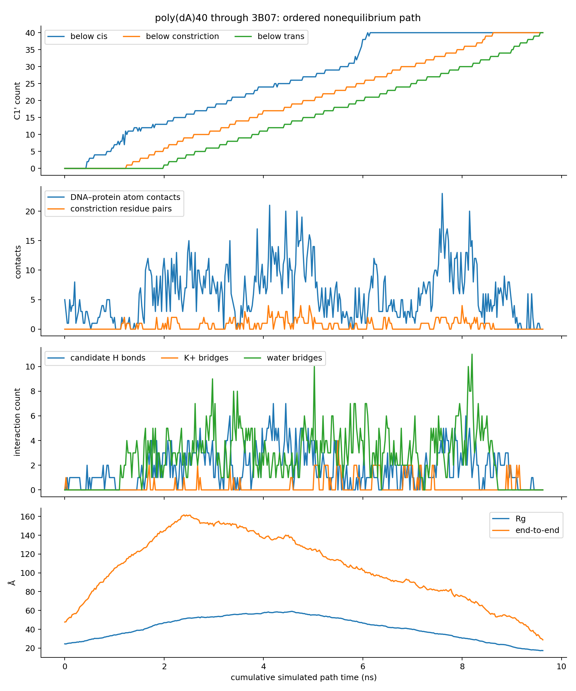
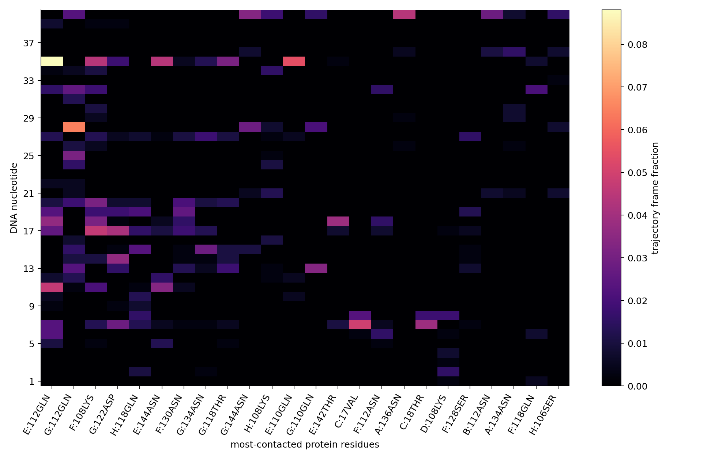
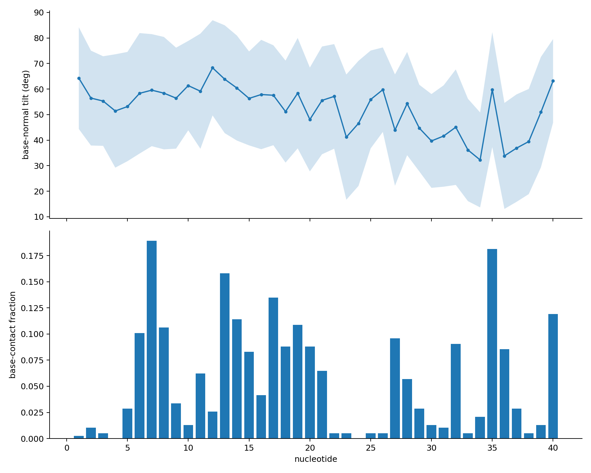

# poly(dA)40–3B07 result

The strict 5′-first pathway reached 40/40 nucleotides on the trans side with no
out-of-order crossing. The assembled pathway contains 386 saved structures and
9.625 ns of cumulative simulated stage time; the first strict 40/40 frame occurs
at 9.575 ns.

[Open the complete trajectory movie](trajectory.mp4)

## Interaction summary

- Mean DNA–protein heavy-atom contact count at 3.5 Å: 6.05 per saved frame;
  maximum: 23.
- Closest DNA–protein heavy-atom separation: 2.56 Å.
- Mean geometric hydrogen-bond candidates: 1.77 per saved frame.
- Mean potassium-mediated DNA–acidic-residue bridges: 0.26 per saved frame.
- Mean DNA–constriction water bridges: 2.67 per saved frame.
- The most persistent protein contacts are E:GLN112 (26.9% of frames),
  G:GLN112 (25.1%), F:LYS108 (24.1%), G:ASP122 (16.6%) and H:GLN118
  (12.7%).
- At the constriction, F:LYS108 contacts bases of nucleotides 17, 18 and 20 and
  the backbone of nucleotide 35. Other recurrent constriction contacts include
  A:THR114 and E:SER140.
- Leading hydrogen-bond candidates include A18-N6/E:THR142-OG1,
  A18-N1/E:GLN112-NE2, A7-N6/C:VAL17-O and A14-N6/G:ASP122-OD2.
- Potassium bridges are concentrated around phosphate oxygens and ASP122,
  especially nucleotides 25 and 28 in chain A.

Occupancies use all 386 saved structures, including frames in which a given
nucleotide is outside the constriction. They describe this one driven pathway
and should not be read as equilibrium binding probabilities.

## Files

- `trajectory.mp4`: annotated movie covering every saved structure.
- `overview.png`: passage progress, global contacts and bridging interactions.
- `contact_heatmap.png`: nucleotide–protein-residue contact occupancy.
- `base_orientation.png`: base orientation and base-contact behavior.
- `pulling_force.png`: biased SMD spring-force trace.
- `timeseries.csv`: frame-level progress, geometry and interaction counts.
- `nucleotide_z.csv`: C1′ z coordinate for every nucleotide in every frame.
- `protein_contact_occupancy.csv`: protein-residue contact occupancy.
- `DNA_protein_residue_pair_occupancy.csv`: nucleotide–residue contacts split
  into base and backbone atoms.
- `constriction_contact_occupancy.csv`: contacts restricted to the constriction.
- `candidate_hydrogen_bond_occupancy.csv`: donor/acceptor geometry occupancy.
- `potassium_bridge_occupancy.csv`: K+-mediated DNA–acidic-residue bridges.
- `base_orientation_and_contact.csv`: per-frame base-normal orientation and
  base/backbone contact counts.
- `pulling_force.csv`: colvars-derived SMD spring-force series.
- `start.pdb`, `endpoint.pdb`, `visualization.psf`: inspectable structures and
  movie topology.
- `summary.json`, `analysis_validation.json`, `movie_validation.json`:
  machine-readable summary and integrity checks.
