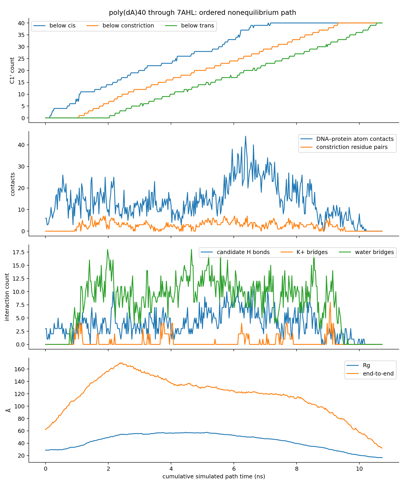
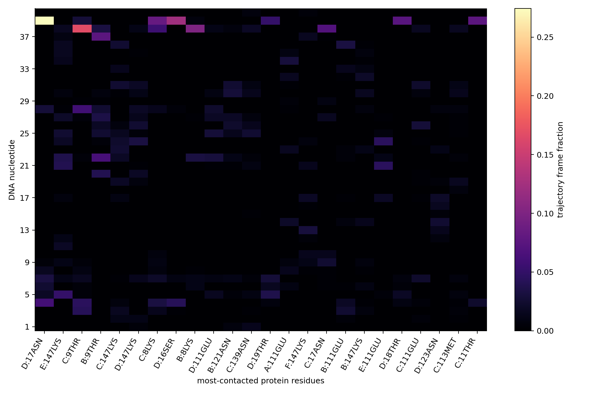
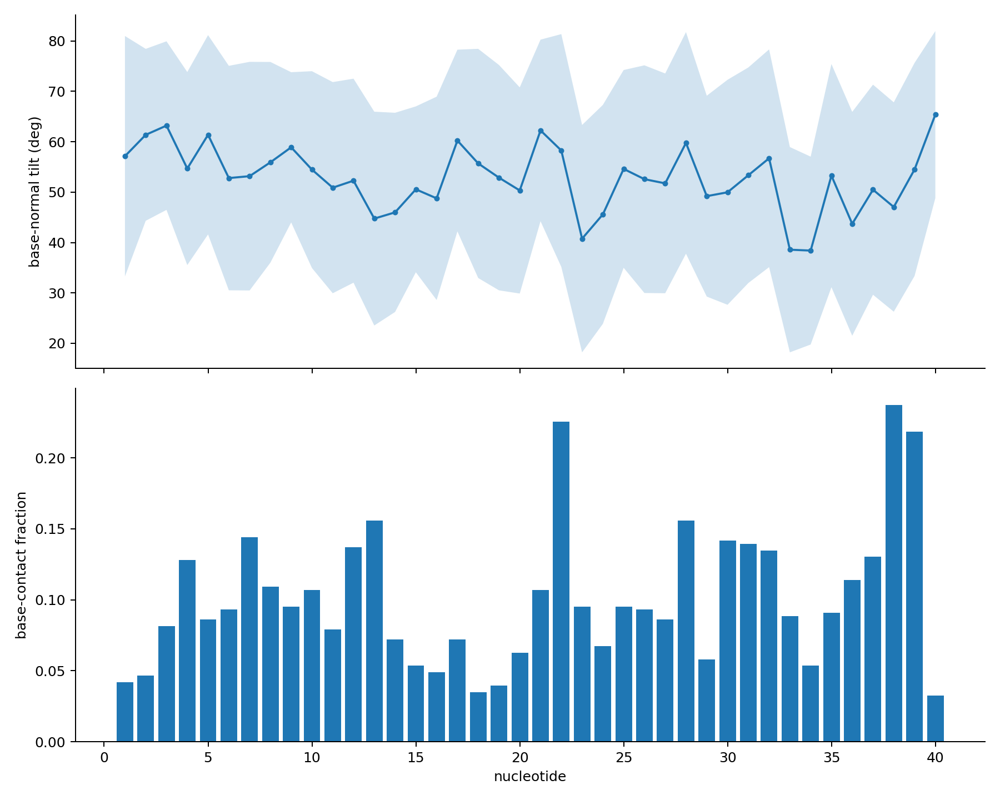

# poly(dA)40–7AHL result

The strict 5′-first pathway reached 40/40 nucleotides on the trans side with no
out-of-order crossing. The assembled pathway contains 430 saved structures and
10.725 ns of cumulative simulated stage time; the first strict 40/40 frame
occurs at 10.550 ns.

[Open the complete trajectory movie](trajectory.mp4)

## Interaction summary

- Mean DNA–protein heavy-atom contact count at 3.5 Å: 13.77 per saved frame;
  maximum: 44.
- Closest DNA–protein heavy-atom separation: 2.49 Å.
- Mean geometric hydrogen-bond candidates: 3.78 per saved frame.
- Mean potassium-mediated DNA–acidic-residue bridges: 0.44 per saved frame.
- Mean DNA–constriction water bridges: 7.93 per saved frame.
- The most persistent protein contacts are D:ASN17 (32.3% of frames), E:LYS147
  (30.0%), C:THR9 (27.2%), B:THR9 (26.3%) and C:LYS147 (22.1%).
- At the constriction, GLU111 and LYS147 contact both bases and backbone from
  several nucleotides; recurrent examples include A21/A24 with E:GLU111 and
  A21/A22 with E:LYS147.
- Leading hydrogen-bond candidates include A39-O2P/D:SER16-OG,
  A39-O1P/C:THR11-OG1, A38-O2P/B:LYS8-NZ and A39-O4′/D:ASN17-ND2.
- Potassium bridges are concentrated around DNA oxygen atoms and GLU111,
  including A17 with chain B and A27 with chain A.

Occupancies use all 430 saved structures, including frames in which a given
nucleotide is outside the constriction. They describe this one driven pathway
and should not be read as equilibrium binding probabilities.

## Files

- `trajectory.mp4`: annotated movie covering every saved structure.
- `overview.png`: passage progress, global contacts and bridging interactions.
- `contact_heatmap.png`: nucleotide–protein-residue contact occupancy.
- `base_orientation.png`: base orientation and base-contact behavior.
- `pulling_force.png`: biased SMD spring-force trace.
- `timeseries.csv`: frame-level progress, geometry and interaction counts.
- `nucleotide_z.csv`: C1′ z coordinate for every nucleotide in every frame.
- `protein_contact_occupancy.csv`: protein-residue contact occupancy.
- `DNA_protein_residue_pair_occupancy.csv`: nucleotide–residue contacts split
  into base and backbone atoms.
- `constriction_contact_occupancy.csv`: contacts restricted to the constriction.
- `candidate_hydrogen_bond_occupancy.csv`: donor/acceptor geometry occupancy.
- `potassium_bridge_occupancy.csv`: K+-mediated DNA–acidic-residue bridges.
- `base_orientation_and_contact.csv`: per-frame base-normal orientation and
  base/backbone contact counts.
- `pulling_force.csv`: colvars-derived SMD spring-force series.
- `start.pdb`, `endpoint.pdb`, `visualization.psf`: inspectable structures and
  movie topology.
- `summary.json`, `analysis_validation.json`, `movie_validation.json`:
  machine-readable summary and integrity checks.
