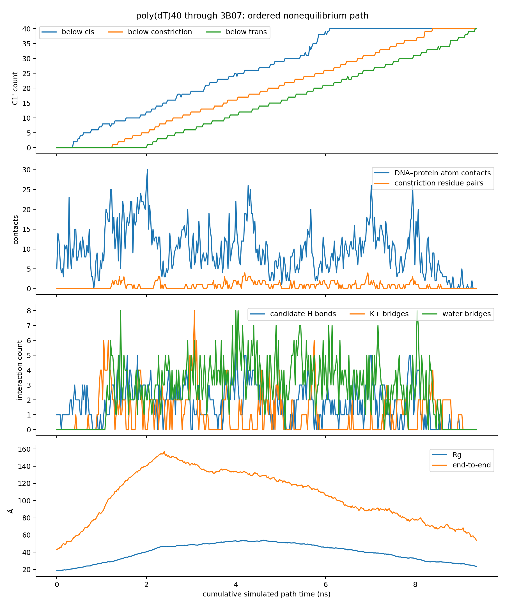
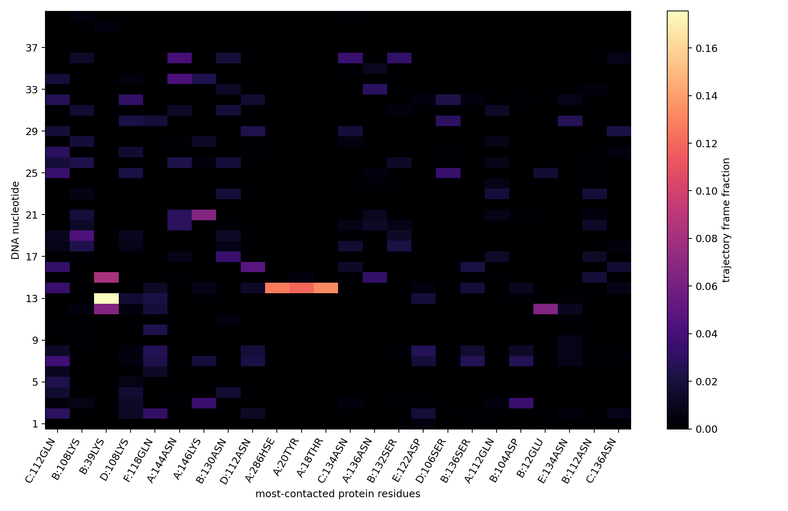
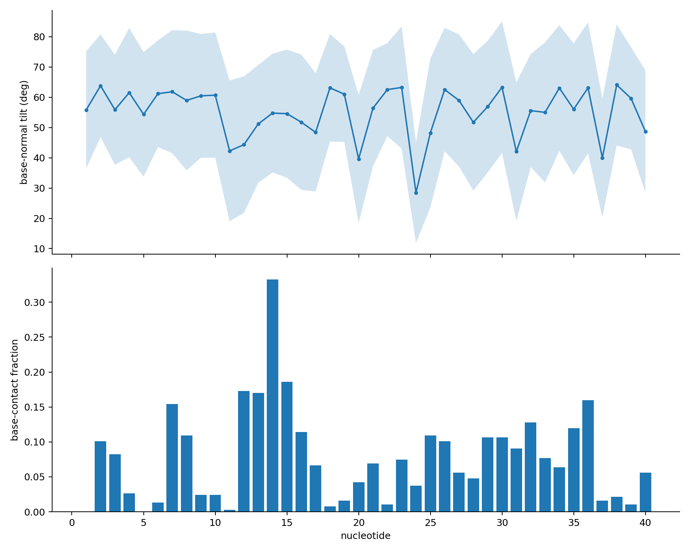

# poly(dT)40–3B07 result

The strict 5′-first pathway reached 40/40 nucleotides on the trans side with no
out-of-order crossing. The assembled pathway contains 376 saved structures and
9.375 ns of cumulative simulated stage time; the first strict 40/40 frame occurs
at 9.350 ns.

[Open the complete trajectory movie](trajectory.mp4)

## Interaction summary

- Mean DNA–protein heavy-atom contact count at 3.5 Å: 9.74 per saved frame;
  maximum: 30.
- Closest DNA–protein heavy-atom separation: 2.49 Å.
- Mean geometric hydrogen-bond candidates: 1.72 per saved frame.
- Mean potassium-mediated DNA–acidic-residue bridges: 1.05 per saved frame.
- Mean DNA–constriction water bridges: 2.71 per saved frame.
- The most persistent protein contacts are C:GLN112 (31.1% of frames), B:LYS108
  (20.2%), B:LYS39 (19.9%), D:LYS108 (18.1%) and F:GLN118 (17.6%).
- At the constriction, LYS108 contacts bases and backbone from several
  nucleotides. Recurrent contacts also involve SER132, including the T36 base.
- Leading hydrogen-bond candidates include T14-N3/A:HSE286-ND1,
  T12-N3/B:GLU12-OE1, T13-O2/B:LYS39-NZ and T21-O1P/A:LYS146-NZ.
- Potassium bridges involve both base and backbone oxygen atoms with acidic
  residues, especially T12/B:GLU12 and several nucleotides with ASP122.

Occupancies use all 376 saved structures, including frames in which a given
nucleotide is outside the constriction. They describe this one driven pathway
and should not be read as equilibrium binding probabilities.

## Files

- `trajectory.mp4`: annotated movie covering every saved structure.
- `overview.png`: passage progress, global contacts and bridging interactions.
- `contact_heatmap.png`: nucleotide–protein-residue contact occupancy.
- `base_orientation.png`: base orientation and base-contact behavior.
- `pulling_force.png`: biased SMD spring-force trace.
- `timeseries.csv`: frame-level progress, geometry and interaction counts.
- `nucleotide_z.csv`: C1′ z coordinate for every nucleotide in every frame.
- `protein_contact_occupancy.csv`: protein-residue contact occupancy.
- `DNA_protein_residue_pair_occupancy.csv`: nucleotide–residue contacts split
  into base and backbone atoms.
- `constriction_contact_occupancy.csv`: contacts restricted to the constriction.
- `candidate_hydrogen_bond_occupancy.csv`: donor/acceptor geometry occupancy.
- `potassium_bridge_occupancy.csv`: K+-mediated DNA–acidic-residue bridges.
- `base_orientation_and_contact.csv`: per-frame base-normal orientation and
  base/backbone contact counts.
- `pulling_force.csv`: colvars-derived SMD spring-force series.
- `start.pdb`, `endpoint.pdb`, `visualization.psf`: inspectable structures and
  movie topology.
- `summary.json`, `analysis_validation.json`, `movie_validation.json`:
  machine-readable summary and integrity checks.
