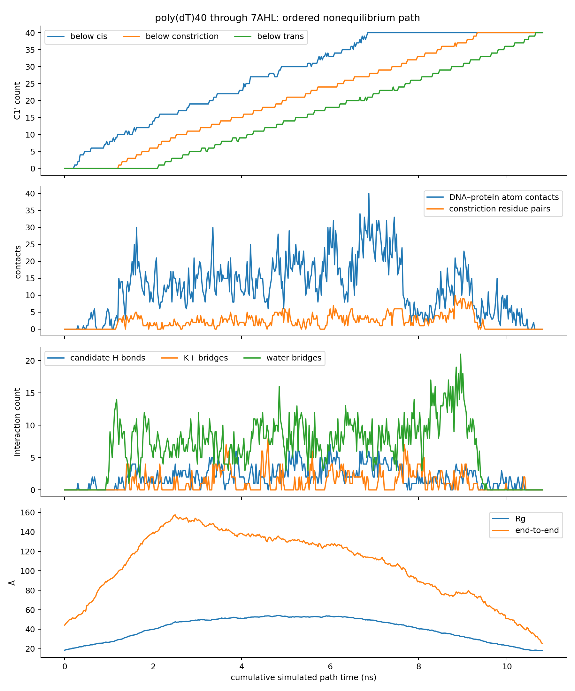
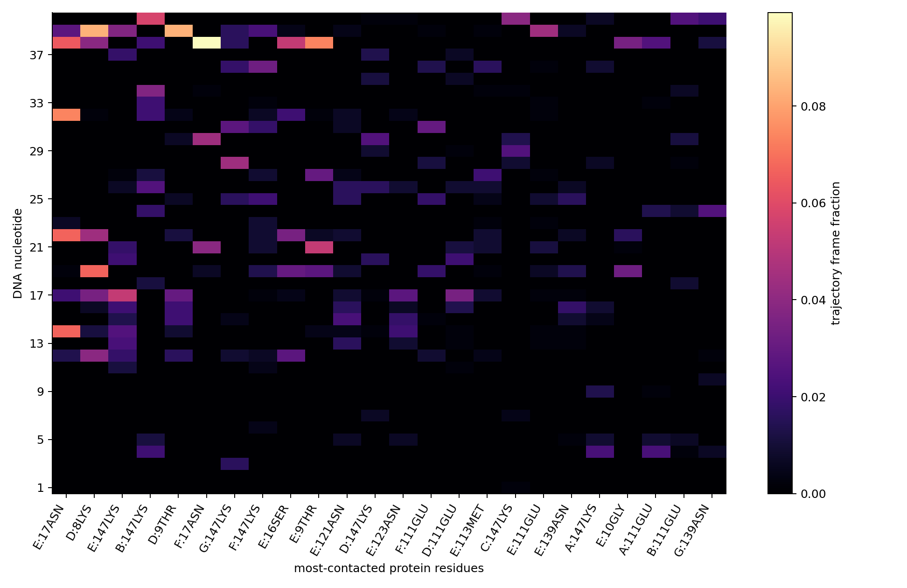
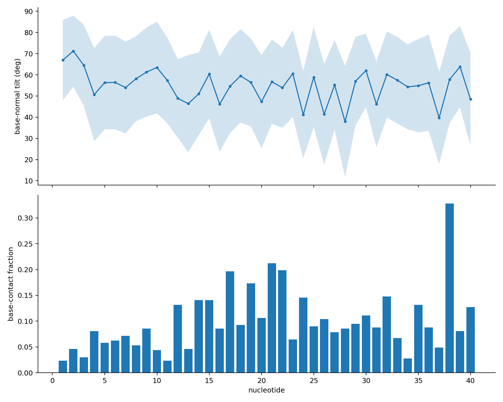

# poly(dT)40–7AHL result

The strict 5′-first pathway reached 40/40 nucleotides on the trans side with no
out-of-order crossing. The assembled pathway contains 433 saved structures and
10.800 ns of cumulative simulated stage time; the first strict 40/40 frame
occurs at 10.650 ns.

[Open the complete trajectory movie](trajectory.mp4)

## Interaction summary

- Mean DNA–protein heavy-atom contact count at 3.5 Å: 12.06 per saved frame;
  maximum: 40.
- Closest DNA–protein heavy-atom separation: 2.49 Å.
- Mean geometric hydrogen-bond candidates: 2.02 per saved frame.
- Mean potassium-mediated DNA–acidic-residue bridges: 1.09 per saved frame.
- Mean DNA–constriction water bridges: 6.48 per saved frame.
- The most persistent protein contacts are E:ASN17 (29.6% of frames), D:LYS8
  (26.1%), E:LYS147 (25.2%), B:LYS147 (23.3%) and D:THR9 (20.6%).
- At the constriction, LYS147 contacts both bases and backbone from several
  nucleotides. Recurrent base contacts also involve GLU111.
- Leading hydrogen-bond candidates include T39-O1P/D:THR9-OG1,
  T39-O2P/D:LYS8-NZ, T32-O4/E:ASN17-ND2 and T34-O1P/B:LYS147-NZ.
- Potassium bridges are concentrated around DNA oxygen atoms and GLU111,
  including T15 with chain G and T26/T28 with chain B.

Occupancies use all 433 saved structures, including frames in which a given
nucleotide is outside the constriction. They describe this one driven pathway
and should not be read as equilibrium binding probabilities. The larger contact
counts than the dA–3B07 pathway cannot be assigned to sequence alone because the
pore, pathway length and sampled geometry also differ.

## Files

- `trajectory.mp4`: annotated movie covering every saved structure.
- `overview.png`: passage progress, global contacts and bridging interactions.
- `contact_heatmap.png`: nucleotide–protein-residue contact occupancy.
- `base_orientation.png`: base orientation and base-contact behavior.
- `pulling_force.png`: biased SMD spring-force trace.
- `timeseries.csv`: frame-level progress, geometry and interaction counts.
- `nucleotide_z.csv`: C1′ z coordinate for every nucleotide in every frame.
- `protein_contact_occupancy.csv`: protein-residue contact occupancy.
- `DNA_protein_residue_pair_occupancy.csv`: nucleotide–residue contacts split
  into base and backbone atoms.
- `constriction_contact_occupancy.csv`: contacts restricted to the constriction.
- `candidate_hydrogen_bond_occupancy.csv`: donor/acceptor geometry occupancy.
- `potassium_bridge_occupancy.csv`: K+-mediated DNA–acidic-residue bridges.
- `base_orientation_and_contact.csv`: per-frame base-normal orientation and
  base/backbone contact counts.
- `pulling_force.csv`: colvars-derived SMD spring-force series.
- `start.pdb`, `endpoint.pdb`, `visualization.psf`: inspectable structures and
  movie topology.
- `summary.json`, `analysis_validation.json`, `movie_validation.json`:
  machine-readable summary and integrity checks.
